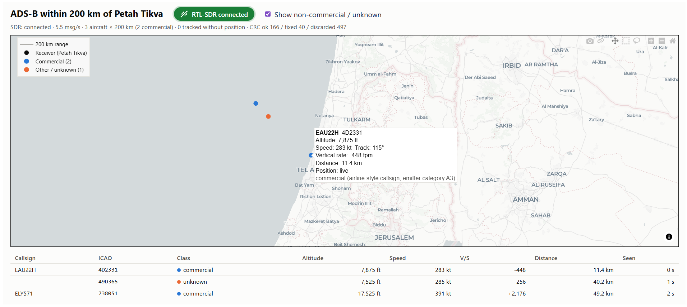
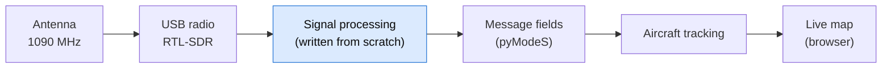
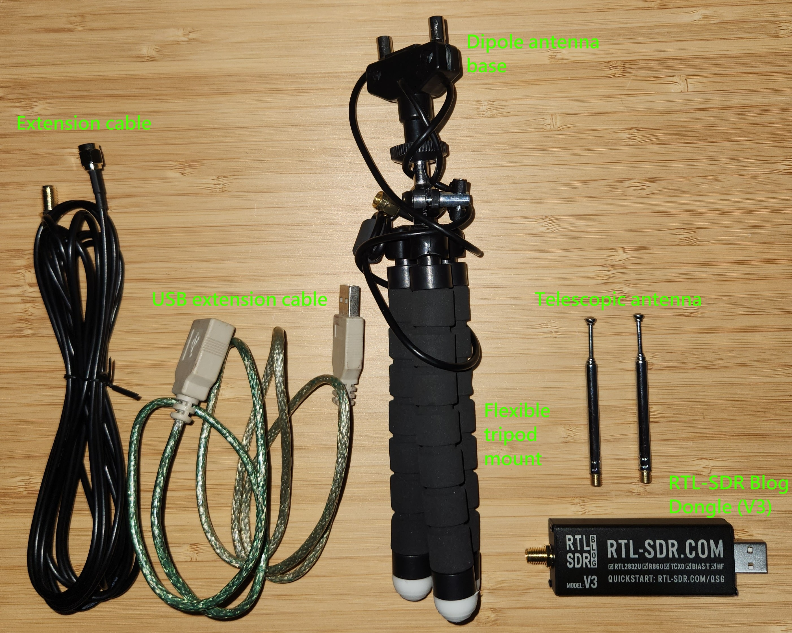

# adsb-il-tracker

**Live aircraft tracking from raw radio signals, with the signal processing written from scratch.**

Aircraft broadcast their identity, position, altitude and speed several times a second on
1090 MHz, a system called ADS-B. This project receives those broadcasts with a low-cost USB
radio (RTL-SDR) and a small antenna, turns the raw signal into verified messages, and shows the
aircraft within 200 km of the receiver in Petah Tikva on a live map.



*A live session: three aircraft near Tel Aviv, with one flight's details shown on hover.
[Reading the map](#reading-the-map) explains each field.*

## Highlights

- **Signal processing implemented from scratch** in Python (NumPy/SciPy): detecting messages in
  the raw signal, recovering their bits, and checking them for errors. A library (pyModeS) is
  only used to read fields out of messages that have already passed the error check.
- **Built for imperfect signals:** detection against the measured noise floor, sub-sample timing
  estimation, a Viterbi bit decoder, and single-bit error correction.
- **Tracking:** messages are merged per aircraft. When position updates stop, the aircraft's
  position is projected forward from its last speed and direction for up to 30 seconds.
- **Tested without hardware:** 121 automated tests run against a simulated radio signal with
  noise, frequency offset and random timing.

## Reading the map

The map refreshes every 2 seconds.

| On the map | Meaning |
|---|---|
| Blue dot | Commercial flight (airline or cargo) |
| Orange dot | Everything else: private, military or government, or not identified yet |
| Faded dot | Estimated position. No position update for 3 s, so the dot is moved forward along the aircraft's last known speed and direction. It is removed after 30 s without an update. |
| Black dot | The receiver |
| Grey circle | The 200 km range. Only aircraft inside it are shown. |

Hover over a dot to see that flight's details. The values below are from the screenshot above.

| Field | Example | Meaning |
|---|---|---|
| Callsign | EAU22H | The flight's radio callsign, usually the airline code plus flight number |
| ICAO address | 4D2331 | The aircraft's permanent unique ID, built into its transponder |
| Altitude | 7,875 ft | Altitude in feet |
| Speed | 283 kt | Ground speed in knots |
| Track | 115° | Direction of travel, clockwise from north (115° is roughly east-southeast) |
| Vertical rate | −448 fpm | Climb (+) or descent (−) in feet per minute |
| Distance | 11.4 km | Distance from the receiver |
| Position | live | `live`, or `estimated` with the time since the last real position |
| Classification | commercial | Commercial or other, with the reason (here, an airline-style callsign and a large-aircraft category) |

Around the map:

- **USB badge:** green when the radio is connected, red when it is disconnected (hover for the
  error), amber while starting.
- **Status line:** messages per second, aircraft in range, and how many messages passed the
  error check, were repaired, or were rejected.
- **Table:** the same aircraft, nearest first, plus aircraft that have been heard but have not
  sent a position yet. *Seen* is the time since the last message.
- **Checkbox:** hides the orange (non-commercial) aircraft.

The receiver location on the map is close to the real antenna site but deliberately not exact,
for privacy.

## How it works



The radio delivers 2 million signal samples per second. The signal processing finds the
aircraft messages in that stream in four steps:

1. **Detect.** Every message starts with a fixed pulse pattern. The code slides a matching
   template along the signal and keeps the matches that stand clearly above the background noise.
2. **Read the bits.** Each message carries 112 bits, each sent as a pulse in the first or second
   half of a 1 µs slot. With only 2 samples per slot, a pulse often falls between two samples.
   A second decoder estimates that timing offset from the start of the message and finds the most
   likely bit sequence with a Viterbi algorithm. Both decoders run on every candidate.
3. **Verify.** Each candidate is checked with the standard 24-bit CRC. A message with one wrong
   bit is repaired. Everything else is rejected and counted, so only verified messages go on.
4. **Stream continuously.** The signal arrives in blocks that overlap slightly, so a message
   that falls across a block boundary is still found. If processing falls behind, old data is
   dropped cleanly instead of being stitched together with a gap.

Verified messages are then decoded into callsign, altitude, speed and position, and merged per
aircraft by its unique ID. An aircraft's position comes from pairing two complementary position
messages. Aircraft are dropped after 60 seconds of silence.

## Hardware

The whole receiver is an off-the-shelf RTL-SDR Blog V3 kit:



- **RTL-SDR Blog V3 dongle:** the USB radio. It tunes to 1090 MHz and streams raw samples to
  the computer, and all the processing happens in this project's code.
- **Dipole antenna:** the base with the two short telescopic elements, each extended to about
  6.5 cm (just under a quarter wavelength at 1090 MHz) and mounted vertically, because ADS-B
  is vertically polarised. The setup notes at the bottom explain the length.
- **Flexible tripod:** holds the antenna upright, for example at a window.
- **Antenna extension cable and USB extension cable:** let the antenna sit higher and closer to
  the window than the computer.

## Running it

You need Python 3.11 or newer, the hardware above with the dongle's driver installed, and the
setup notes at the bottom of this page.

```powershell
pip install -r requirements.txt
python app.py
```

The map opens in the browser at http://127.0.0.1:8050. The app also starts without the dongle
plugged in: the badge shows *disconnected*, and it connects by itself once the dongle is plugged
in.

To run the tests (no hardware needed):

```powershell
python -m pytest
```

## Known limitations

- **ADS-B only.** Aircraft that don't broadcast ADS-B, such as many military aircraft, don't
  appear. Flight-tracking websites locate some of them by combining several receivers
  (multilateration), which one receiver can't do.
- **Timing edge case.** Messages whose pulses land almost exactly halfway between two samples
  decoded about 75% of the time at 20 dB SNR in a test sweep, against 100% at other timings.
  Sampling at 2.4 MS/s with a different bit decoder would close this gap.
- **Classification is a best guess.** Commercial or other is inferred from the callsign
  pattern, known airline and military prefixes, and the size category the aircraft broadcasts.
  Private jets with company callsigns, for example, can be misclassified, so it is shown as a
  label and never used to drop aircraft.
- **Map background needs internet.** Receiving and decoding run fully offline, but the map tiles
  are downloaded from CARTO. Without internet the table and status line still work.

<details>
<summary><b>Setup details: environment, antenna, gain tuning</b></summary>

### Python environment

Developed and tested on Python 3.13.

```powershell
py -3.13 -m venv .venv
.\.venv\Scripts\Activate.ps1          # Linux/macOS: source .venv/bin/activate
pip install -r requirements.txt
```

### Dongle driver

Developed on an RTL-SDR Blog V3. See the
[RTL-SDR Blog quick start guide](https://www.rtl-sdr.com/qsg) for drivers. On Windows,
`pyrtlsdr[lib]` already includes `librtlsdr.dll`, so only the Zadig/WinUSB driver step is needed.

### Antenna (stock dipole)

- Use the short telescopic pair and extend each element to about **6.5 cm** from the centre of
  the base. A full wavelength at 1090 MHz is 27.5 cm, so an exact quarter wave is 6.9 cm, and
  6.5 cm allows for the end effect. Anything from 6.5 to 6.9 cm works about the same, since a
  dipole tolerates a few millimetres either way.
- Mount it **vertically in a straight line**, one element up and one down. ADS-B is vertically
  polarised, so a horizontal or V-shaped layout loses a lot of signal.
- Place it as high as possible with a clear view of the horizon, a few cm away from metal.
  Indoors, an open window is much better than a closed one, because glass (especially coated
  double glazing) blocks much of the signal.

### Gain tuning

Run `python acquire.py` while aircraft are overhead. It prints 5 seconds of signal levels.

- If `max` sits at about 1.0 or `clipped` is above roughly 0.1%, lower `SDR_GAIN_DB` in
  `config.py` by a step or two.
- If `p99.9` barely rises above the median during busy periods, raise it.

After that, the best judge is the message rate in the status line: try a few values for about
10 minutes each and keep the one with the highest msg/s.

</details>

<details>
<summary><b>Code map and configuration</b></summary>

| File | Role |
|---|---|
| `config.py` | All settings: receiver location, range, radio gain and sample rate, detection thresholds, refresh rate, classification lists |
| `acquire.py` | Reads raw samples from the RTL-SDR. Run it directly for a signal-level check |
| `decode.py` | The signal processing (`Demodulator`) and message-field parsing (`MessageParser`) |
| `tracker.py` | Per-aircraft state, position estimation and expiry |
| `geofilter.py` | Distance from the receiver, the range filter, and classification |
| `pipeline.py` | Background threads for receiving and decoding, plus reconnecting the dongle |
| `app.py` | The map dashboard (Plotly Dash) |
| `tests/` | Automated tests. `tests/synth.py` generates the simulated radio signal |

The simulated signal models the pulses at 20 times the sample rate and then adds sub-sample
timing, frequency offset, random phase and noise. The tests cover CRC checking and repair,
decoding at every timing offset, in noise and across block boundaries, garbage input, position
decoding, tracking and expiry, dongle unplug and reconnect, and the dashboard.

</details>
